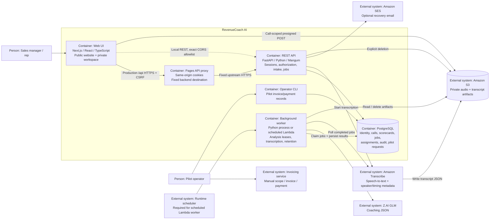

# Architecture

RevenueCoach has a public website and a private coaching workspace. Next.js exports the UI as static assets. FastAPI owns identity, authorization, calls, rubric versions, assignments, and pilot requests. PostgreSQL holds relational entities and JSON scorecards plus a small job queue. A Python worker processes jobs independently of browser requests.

## C4-Style Container Diagram

The diagram describes logical containers, not proof that a cloud deployment is running. Local Compose has four services: UI, API, worker, and PostgreSQL. Production can run the API behind AWS API Gateway/Lambda and the worker as a separate scheduled Lambda or persistent process. The Pages proxy is not a second application backend or an open proxy.

## Runtime Flows

### Identity and Workspace Scope

Signup creates an organization and manager. Passwords use salted PBKDF2-SHA256. The browser holds an expiring HttpOnly session cookie; only the token hash is stored. Mutation requests require a session-bound CSRF token and an allowed Origin when present.

Managers create expiring, single-use invitation links. Rep invitations attach a private rep profile. Every private query is scoped to the authenticated organization; reps see only their own calls and assignments. Managers can suspend seats and change roles without removing the last active manager. Password changes/recovery revoke existing sessions. SES recovery is optional and fails explicitly when unavailable.

Public signup does not grant paid processing access. Only the privileged operator CLI can enable a workspace after recording actual pilot payment. Audio authorization/start and real model jobs enforce that flag. Operators can disable future processing without hiding existing call reviews.

### Transcript Scoring

1. Intake checks workspace/rep ownership, consent, input limits, and the contact-redaction policy.
2. Transcript lines become stable segments; supplied timestamps and known role labels are preserved.
3. Analysis creates one job per call and saves the complete rubric/context snapshot. Repeated requests reuse the pending job or finished scorecard.
4. A worker atomically claims a five-minute lease, releases the database session during the model request, and validates the typed output.
5. Each non-null category needs a source-matching excerpt. Speakers/timestamps are replaced with source metadata. The backend computes the weighted total using only observed categories and records observed rubric-weight coverage.
6. The worker rechecks lease ownership before storing the result. Provider, parsing, and grounding failures produce a failed, retryable job, not a synthetic score.
7. The UI polls persisted state and can navigate from an excerpt to its source segment.

A deliberately separate onboarding route creates a synthetic sample with matching, predefined annotations. Real metrics exclude `sample` and `legacy` records. Older analyses are not retroactively presented as verified.

### Audio

A call must exist before the API issues a presigned POST under its organization/call prefix. The API starts Transcribe only for that saved key. The worker polls jobs, reads source speaker labels and word timings, and persists grouped segments. Labels such as `spk_0` are preserved; they are not falsely relabeled as buyer/rep. No tone/emotion classifier is implemented.

If contact redaction is enabled, the worker redacts text and deletes raw audio/transcript artifacts before marking the transcript ready. A dependency/cleanup failure remains visible and retryable. Completed transcription never regresses an analyzed call.

### Coaching and Measurement

A manager assigns one rubric skill and an exercise from a verified scorecard. A rep submits practice; a manager records feedback. Optional verification uses a later call by the same rep, with an identical rubric/context snapshot and source mode, and observed scores on both calls.

The dashboard separates assigned, awaiting-review, and reviewed exercises. Real-call average scores use the current rubric version. Manager ratings and optional reported review seconds cover the last 30 days and exclude sample/legacy results. These measures do not establish revenue causation.

### Cleanup

Deletion and scheduled retention remove linked S3/Transcribe artifacts before deleting call data. Failed cleanup keeps the database record for retry and audits the failure. Call deletion cascades scorecards, jobs, and source-call assignments. Deleting a verification call clears its saved comparison so unsupported improvements disappear from reporting. Expired sessions, invitations, recovery links, and quota buckets are also cleaned up.

## Deployment Shape

- Local: API migrations run after PostgreSQL becomes healthy; the worker starts only after API schema readiness.
- Pages: static `out` plus `functions/api/[[path]].ts`. Only API paths invoke the proxy. Runtime configuration fixes the upstream; secrets are not compiled into the client.
- Backend: Uvicorn/container or Mangum/Lambda with access to PostgreSQL and external services.
- Worker: persistent process or scheduled handler. The API never spawns in-memory background tasks that could be abandoned when a Lambda invocation ends.
- Migrations: Alembic, including the private-RDS migration handler. Unversioned legacy databases require explicit operator inspection and stamping; no destructive automatic reset.

See the [deployment and pilot runbook](product-readiness.md) for required environment settings and startup order.

## Constraints

- The PostgreSQL job table is right-sized for low-volume pilots, not an unlimited queue. Model timeout is bounded; expired leases may be reclaimed up to three attempts. Delivery is at least once, so a crash can repeat a paid model request even though storage is idempotent.
- The worker must run. Readiness verifies the database schema and reports configuration, not provider availability or worker liveness.
- SQLite is supported for tests/local previews; production concurrent workers should use PostgreSQL row locks.
- Exact quote validation establishes provenance, not semantic accuracy of every score, inference, or follow-up draft. Human review and a consented evaluation set remain necessary.
- Redaction detects contact/long-number patterns, not all identifying or sensitive information. Cloud logs, backups, and S3 version history need separate retention controls.
- Signup does not verify email; SSO/MFA and enterprise policy controls are not implemented.
- An account belongs to one workspace. Moving an existing account between workspaces or joining multiple teams is not implemented.
- Audio is batch US-English transcription with at most two speaker labels; there is no real-time audio or automatic speaker-to-sales-role assignment.
- The existing AWS shutdown record is historical. Cloud resources and billing must be inspected separately before deployment.
